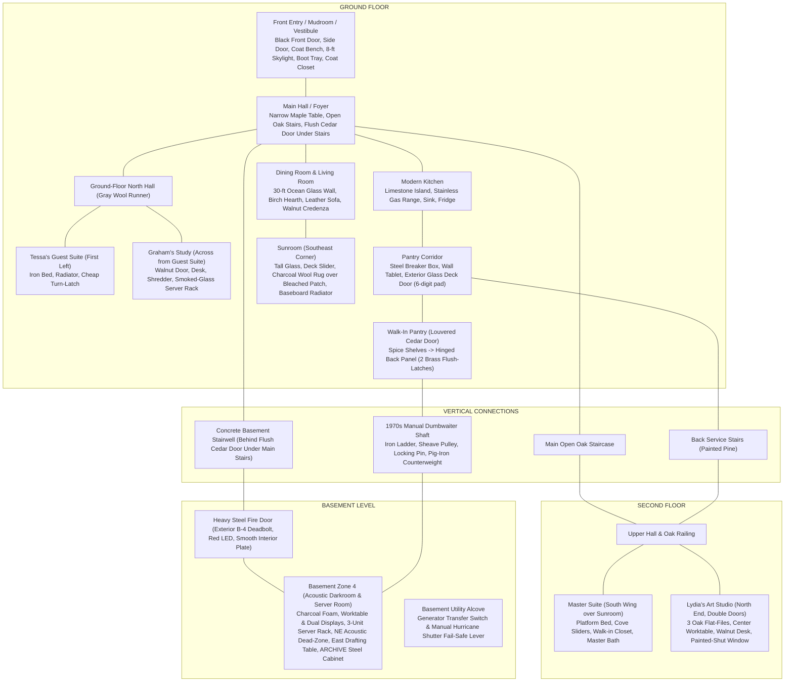

# BOOK 1 — LOCATION AND HOUSE BIBLE (`LOCATION_AND_HOUSE_BIBLE.md`)

## 1. Regional & Exterior Geography (Salt Point & Midcoast Maine)

### 1.1 Regional Orientation
- **Salt Point Peninsula & Causeway (Knox County, Maine):**
  - Fictional coastal peninsula on **Penobscot Bay** in **Knox County, Maine** (patrolled by the Knox County Sheriff's Office and within 15–20 minutes' drive of **Rockland**, **Camden**, and the Maine State Police barracks in **Thomaston** via **Route 1**).
  - Approx. **90 miles north of Portland, Maine** via I-95 and Route 1 (`"ninety miles south"`, Ch. 7, line 101; Ch. 12, line 21; Tessa drives up past Brunswick in Ch. 1, line 3).
  - **The Salt Point Causeway:** Low-lying wet strip of asphalt sitting barely above the tide line, hemmed in by black granite and dark water, with steel guardrails and a concrete culvert bolted with rusted tide markers (Ch. 1, lines 3–5; Ch. 18, line 75). During the Thursday, November 5 **5:15 PM spring high tide and east gale**, storm surge tops the culvert and floods the causeway asphalt (Ch. 5, line 71; Ch. 16, line 43; Ch. 17, line 59; Ch. 18, line 75).
  - **Cellular Reception Boundary:** Cell service drops from four bars at the mainland fork (past the **Salt Point firehouse**) down to zero past the **lobster pound** and clings to a single weak bar on the Kiefer peninsula (Ch. 1, line 7; Ch. 5, line 7); inside Basement Zone 4, poured concrete and acoustic foam drop signal to `NO SERVICE` (Ch. 11, line 53; Ch. 13, line 21).
- **Mainland Fork & Roads:**
  - **Coastal Road (past the lobster pound):** Secondary route; Graham claims on Tuesday that a county crew is patching a culvert washout here (Ch. 4, line 87).
  - **Main Harbor Route (Harbor Road):** Passes the Salt Point firehouse and a four-way stop, leading into Salt Point harbor (Ch. 5, lines 7–9, 57).
- **Salt Point Harbor (Town Crossroads):**
  - Barely a crossroads: a brick post office, a shuttered bait shop, a diesel dock where three lobster boats rock against black pilings, and a clapboard general store with a brass door bell, buzzing fluorescents, work-glove rack, coffee urns, and corkboard of tide tables (Ch. 5, lines 57–67).
- **Maren Lindqvist's Oyster Sorting Shed & Mudflat:**
  - Located across the flat mud channel from Kiefer's cove (visible to the left when crossing the causeway and visible from the Kiefer seaward deck and bluff steps, Ch. 1, line 5; Ch. 3, line 99).
  - **Structure:** Gray shingle box squatting on timber pilings where the granite ledge flattens into crushed oyster shell, tied down with galvanized turnbuckles (Ch. 1, line 5; Ch. 9, line 15).
  - **Exterior:** Corrugated tin awning over black plastic oyster cages and a sorting table; one caged yellow/amber bulb over the loading door (with an exterior padlock hasp and latch); gravel apron with an iron ringbolt where Maren chains her dented flat-bottomed aluminum skiff (Ch. 1, line 5; Ch. 3, line 103; Ch. 9, lines 15–19; Ch. 18, lines 43–45).
  - **Interior:** Tight, damp workspace heated in the center by a kerosene heater with a damper and tin stovepipe; cluttered workbench stacked with hose fittings, tide almanacs, twine spools, and rusted wire cutters (Ch. 9, lines 41–75).
  - **Access:** Connected both to Harbor Road (via pickup ruts/lane across the culvert, Ch. 18, line 43) and to the Kiefer bluff via the shoreline path and the lobstermen's stone/railroad-tie switchback trail (Ch. 9, lines 9–15; Ch. 22, line 49).

---

## 2. The Kiefer Property — Exterior & Bluff Grounds

- **Ownership & Architectural Heritage:**
  - Owned by a Delaware LLC (Ch. 1, line 7). Originally a **1970s stone cottage** owned by Lydia's family; rebuilt by bolting modern two-story ocean glass and dark steel onto the original 1970s stone foundation, chimney, and hemlock-framed utility chase (Ch. 1, line 17; Ch. 11, line 47).
- **Driveway & Timber Gate:**
  - Two cedar posts flank a hydraulic timber barrier gate at the neck of the drive, controlled by a salt-crusted brass keypad on a rusted pipe (4-digit PIN) and remote app link (Ch. 1, lines 11–15; Ch. 6, line 5; Ch. 7, line 5).
  - A spruce-lined gravel lane (with a gravel spur, Ch. 16, line 5) leads up to the gravel turnaround outside the house, which has a dead floodlight pole (Ch. 1, lines 15–19), an attached garage bay (Ch. 10, line 3), and a wet slate walk leading to the front porch landing under a cedar overhang (Ch. 1, line 21; Ch. 19, line 13).
- **Seaward Deck, Cliff Steps & Cove Trail:**
  - **Seaward Cedar Deck:** Wraps the seaward (east) side of the house outside the dining/kitchen back glass sliders and the sunroom glass slider (Ch. 3, line 93; Ch. 4, line 7; Ch. 7, line 89).
  - **Granite Cliff Steps:** Directly below the deck rail, steep granite/slate steps **with no handrail** zig-zag down the bluff to the Kiefer boathouse; lower risers are coated in slick green algae and black lichen (Ch. 1, line 87; Ch. 3, line 93; Ch. 16, line 41). Halfway down sits a **narrow cedar landing under a twisted pitch pine** overlooking the seawall and boathouse roof (Ch. 9, line 89).
  - **Lobstermen's Cove Switchback Trail:** Narrow stone path chewed out of the ledge with rotting railroad ties, connecting the lawn/spruces and mid-cliff landing down to Maren Lindqvist's crushed-shell beach (Ch. 8, line 63; Ch. 9, lines 9–15).
- **The Kiefer Boathouse:**
  - **Exterior:** Dark timber and nearly black weathered cedar shingles squatting over pilings at the bottom of the cliff steps (Ch. 3, line 97; Ch. 16, line 49).
  - **Double Plank Doors (Facing the Cliff):** Secured by a single heavy brass padlock at the exterior hasp and bridged by a faded strip of county paper seal **torn/sliced cleanly in two** (Ch. 3, line 97; Ch. 9, line 91; Ch. 16, line 49); salt-clouded transom window above the double doors (Ch. 16, line 67).
  - **Cliff-Side Casement Window (North/Rock Wall Side):** Narrow frosted glass casement window with an interior shutter and a rusted interior hook-and-eye latch; its bottom exterior gray paint seam was sliced clean with a sharp blade so it can be pried open from outside (Ch. 3, line 97; Ch. 9, line 93; Ch. 16, lines 55–61).
  - **Interior Layout:**
    - Damp cedar decking over open water and an open **slipway gap** (with a submerged slipway cross-beam below, Ch. 16, line 67; Ch. 18, line 21; Ch. 22, line 93).
    - **Suspended Yellow Kayak:** Long yellow fiberglass sea kayak suspended at shoulder height from the rafters on rope slings, blocking off the back corner (Ch. 9, line 95; Ch. 16, lines 69, 81).
    - **Scarred Cedar Workbench (Far Wall):** Lower shelf holds two plastic gallon jugs (industrial bleach) and a pair of cedar oars with fresh pale scratches through the blade varnish under a blue tarp (Ch. 16, lines 67, 73).
    - **Bait Table & Teak Piling:** Bait table bolted flush to a thick creosote-soaked **teak slipway piling** (Ch. 17, lines 11–15). Wedged blade-out in a split seam under the bait-table rail behind the piling is a **rusted oyster knife with a swollen oak handle** (Ch. 17, line 35). Bolted under the lower cross-brace in shadow sits the live **`BOATHOUSE_LINT` PoE microphone puck** with a steady blue LED, wired into a waterproof conduit running up the cliff to Basement Zone 4 (Ch. 17, line 37).
    - **Stacked Lobster Traps & Coiled Dock Lines:** Stacked along the decking (where Lydia kicks Tessa's phone and Cole steps on it, Ch. 16, line 67; Ch. 17, line 9; Ch. 18, line 15).
    - **Missing Rusted Bronze Dock Cleat:** Pried off the boathouse dock and planted in Tessa's Civic spare-tire well (Ch. 14, line 113).

---

## 3. The Kiefer House — Floor-by-Floor Architectural Reference

### 3.1 Distinct Doors, Corridors & Staircases (Anti-Confusion Matrix)

Per Part 3.5 instructions, every door, corridor, and staircase in the Kiefer house is distinguished below:

| Architectural Element | Exact Location & Description | Lock / Security Hardware | Chapters Referenced |
|---|---|---|---|
| **1. Front Entry Door ("the black door" / front vestibule door)** | Main entrance off the front slate walk and porch landing into the front entry/vestibule/mudroom, flanked by glass sidelights. | Exterior rotating keypad + brass key cylinder; described as a motorized smart-lock deadbolt in Ch. 1 (line 23), thrown shut from inside by Cole in Ch. 19 (line 39), and described as a `"double-keyed lock beside the sidelight"` unlocked from inside by Graham with Tessa's brass key in Ch. 22 (line 21). *(See Section 4.1 for continuity flag).* | Ch. 1, 2, 4, 6, 14, 15, 19, 22 |
| **2. Mudroom Side Door** | Secondary exterior door in the mudroom near the garage bay / north blind siding. | Mechanical deadbolt throw tested by Cole (Ch. 8, line 57); used by Tessa to slip out to the cove trail (Ch. 9, line 9) and back in as Graham's garage bay opens (Ch. 10, line 3). | Ch. 8, 9, 10, 13 |
| **3. Vestibule Skylight Hatch** | Low skylight hatch set ~8 feet up into the pitched roof of the front entry/vestibule directly above the cedar coat bench; **the only bare glass left uncovered above the exterior metal hurricane shutter boxes**. | Brass skylight crank latch on the interior frame (unlatched by Lydia standing on the coat bench in Ch. 21, line 89). | Ch. 1, 14, 21, 22 |
| **4. Exterior Glass Deck / Pantry Door** | Glass door at the end of the pantry corridor opening onto the seaward back deck beside the kitchen wall. | Exterior lit brass keypad (6-digit code, green/amber LED, electronic deadbolt) monitored by the back-deck wide-angle camera. Entered by Cole at 11:00 AM Wednesday (Ch. 7, lines 89–99; Ch. 8, line 101). | Ch. 7, 8, 11, 18 |
| **5. Sunroom Glass Slider** | Wide sliding glass patio door in the southeast sunroom opening onto the seaward cedar deck. | Interior brass thumb-latch on a sealed slider track; covered on the exterior by a gravity-drop steel hurricane shutter track (Ch. 4, 12, 16, 18, 20). | Ch. 3, 4, 12, 16, 18, 20 |
| **6. Louvered Walk-In Pantry Door** | Interior louvered cedar door with angled wooden slats opening **outward** into the pantry corridor across from the gray steel breaker box. | Non-locking brass ball-catch knob (wedged shut from the outside by Lydia at 2:34 AM using a wooden kitchen chair jammed under the exterior knob, Ch. 8, line 11; Ch. 13, lines 13–17). | Ch. 8, 11, 13, 19, 21 |
| **7. Hinged Pantry Spice-Rack Panel (Dumbwaiter Hatch)** | Back cedar wainscoting wall of the walk-in pantry behind the middle spice shelf; entire wall and shelf cleats swing outward into the pantry on hidden piano hinges. | Two countersunk brass flush-latches behind the middle spice jars, turned a quarter-inch with a flathead screwdriver tip (Ch. 8, line 33; Ch. 11, lines 31–43; Ch. 13, 19, 21). | Ch. 8, 11, 13, 19, 21, 22 |
| **8. Flush Cedar Basement Stairwell Door (Upper Door)** | Flush wood/cedar door tucked into the paneling underneath the open main oak staircase in the front hall/foyer. | Unlocked interior latch (Ch. 1, line 91; Ch. 6, line 125; Ch. 7, line 21; Ch. 19, line 63; Ch. 21, line 83). Leads down concrete steps to the Basement Zone 4 steel fire door. | Ch. 1, 6, 7, 13, 14, 19, 20, 21, 22 |
| **9. Basement Zone 4 Heavy Steel Fire Door (Lower Door)** | At the bottom of the concrete stairwell beneath the foyer stairs, sealing Basement Zone 4. | Pneumatic closer; matte brass exterior mortise knob and heavy steel deadbolt operated by the warded **`B-4` brass key** from the stairwell side; red/dark pinpoint armed status LED set into the frame; **smooth interior brass plate with NO keyhole and NO thumb-turn on the Zone 4 side** (disabled interior egress, Ch. 1, 7, 12, 13, 14, 21). | Ch. 1, 7, 12, 13, 14, 19, 21, 22 |
| **10. Main Open Oak Staircase** | Floating/open oak staircase climbing from the left side of the main hall/foyer to the second-floor landing and upper hall. | Open balustrade/railing overlooking the main hall (Ch. 1, line 37; Ch. 4, line 81). | Ch. 1, 2, 3, 4, 8, 11, 15 |
| **11. Back Service Stairs** | Narrow painted-pine enclosed staircase running from the upper hall down to a bottom landing at the pantry corridor (between the walk-in pantry and the exterior glass deck door). | Open stairwell landings top and bottom; used by Tessa in socks to avoid detection in the front hall (Ch. 7, line 109; Ch. 8, line 5; Ch. 10, line 5). | Ch. 7, 8, 10 |
| **12. 1970s Manual Dumbwaiter Shaft** | Vertical utility chase framed in rough hemlock studs and cinderblock dropping straight from behind the walk-in pantry spice rack to a concrete ledge three rungs above the floor of Basement Zone 4. | Vertical iron service ladder bolted to the right cinderblock wall; upper-left cast-iron sheave pulley with taut braided hemp rope, removable steel locking pin (with ring loop) in stop bracket, and suspended rectangular pig-iron counterweight inside a side wooden guide channel (Ch. 11, lines 47–61; Ch. 19, lines 35–85; Ch. 21, line 35). | Ch. 8, 11, 12, 13, 14, 15, 19, 20, 21, 22 |

---

## 4. Architectural & Spatial Audit Findings

### 4.1 Flagged Spatial & Hardware Inconsistencies
1. **[HIGH] Front Entry Door Lock Mechanism (`Smart-Lock` vs. `Interior Thumb-Turn` vs. `Double-Keyed Deadbolt`) (Ch. 1, line 23; Ch. 19, line 39; Ch. 22, line 21):**
   - *Details:*
     - In Ch. 1, line 23, the front door deadbolt is an automated smart-lock (`"Before I can knock, the smart-lock deadbolt snaps open on its own"`).
     - In Ch. 19, line 39, Cole walks in the front door and throws the deadbolt shut from the inside (`"followed by the rattle of the front deadbolt throwing shut from inside"`), even though Cole does not have Graham's key ring (which is sitting on the study desk, Ch. 19, line 51).
     - In Ch. 22, lines 19–21 (after power is cut in Ch. 20), Tessa has to dig her brass front-door key out of her jeans and toss it to Graham so he can unlock `"the double-keyed lock beside the sidelight"` from the inside for the Maine State Police.
   - *Resolution:* Either (a) the front door has a standard interior thumb-turn (so Graham doesn't need Tessa's key to open it from inside in Ch. 22), or (b) it has a double-cylinder deadbolt and Cole used a key on his sheriff's ring to lock it from inside in Ch. 19, line 39.
2. **[MEDIUM] Front Entry / Mudroom / Vestibule Layout & Nomenclature (Ch. 1, line 35 vs. Ch. 7, line 5; Ch. 8, line 57; Ch. 10, line 3; Ch. 15, line 19):**
   - *Details:* In Ch. 1, line 35, Tessa states: `"The front entry is a low, chilly mudroom tacked onto the main two-story wing... A coat bench and tall closet line one wall. Above the bench, rain taps on a skylight hatch set low into the pitched roof"`. Later chapters refer to this same front room with the skylight, coat bench, boot tray, and coat closet as `"the front vestibule"` (Ch. 7, 14, 15, 19, 21, 22), while also referencing `"the mudroom side door"` near `"Graham's garage bay"` (Ch. 8, line 57; Ch. 10, line 3) and `"the mudroom sink"` (Ch. 15, line 19).
   - *Resolution:* The space functions coherently as a single L-shaped or continuous front entry/mudroom vestibule wing that has both the main front porch door (with sidelights) and a side utility door to the garage/driveway turnaround, plus a utility sink. Clarifying in Ch. 1, line 35 that the entry vestibule connects directly to the side mudroom door and garage bay eliminates any ambiguity.
3. **[LOW] Basement Zone 4 Steel Fire Door Swing Direction (Ch. 13, line 79 vs. Ch. 21, line 75):**
   - *Details:* In Ch. 13, line 79, the fire door `"swings inward on its pneumatic closer"` into Zone 4 when Graham opens it from the stairwell. In Ch. 21, line 75, after sprinting out of Zone 4 into the stairwell, Tessa says `"I haul the steel door swinging inward... A split second later I throw my whole weight into the steel, slamming it shut"` to trap Cole inside.
   - *Resolution:* If the door swings *into* Zone 4 (Ch. 13), someone in the stairwell **pulls** it shut toward the stairwell frame; if it swings *out* into the stairwell, someone in the stairwell **pushes/throws their weight into it** to slam it shut. Adjust the verb in either Ch. 13, line 79 or Ch. 21, line 75 so the swing direction matches.

### 4.2 Verified Spatial Blocking Sequences (`[CONSISTENT]`)
- **[CONSISTENT] Chapter 8 Walk-In Pantry Sightlines:** From behind the angled slats of the louvered cedar pantry door, Tessa looks straight across the narrow pantry corridor at the gray steel breaker box and wall tablet, and diagonally past the kitchen island toward the mudroom arch and the foot of the main stairs (Ch. 8, line 15). All of Cole's actions are within plausible visual or auditory range.
- **[CONSISTENT] Chapter 19 Dumbwaiter Counterweight Drop:** The pig-iron counterweight travels inside a recessed wooden guide channel *beside* the vertical iron ladder (Ch. 11, line 49; Ch. 19, lines 59, 73), allowing Tessa to hang on the top three ladder rungs and pull the overhead pulley locking pin without being struck by the falling counterweight.
- **[CONSISTENT] Chapter 20–21 Hurricane Shutters & Vestibule Skylight Escape:** Planted in Ch. 1, line 35 (`"a skylight hatch set low into the pitched roof—eight feet up, tops—the only bare glass left uncovered above the metal shutter boxes mounted over the lower windows"`), triggered in Ch. 20, line 93 (gravity-drop steel shutters seal all ground-floor windows), and paid off in Ch. 21, lines 85–89 (Lydia drags the coat bench under the 8-foot vestibule skylight hatch as the only unshuttered opening in the house).
